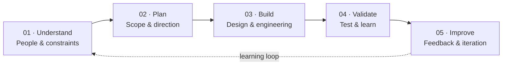

  <picture>
    <source
      media="(prefers-color-scheme: dark)"
      srcset="https://raw.githubusercontent.com/ABE-TechLab/.github/main/profile/assets/abe-techlab-mark-dark.svg"
    />
    <source
      media="(prefers-color-scheme: light)"
      srcset="https://raw.githubusercontent.com/ABE-TechLab/.github/main/profile/assets/abe-techlab-mark-light.svg"
    />
    
  </picture>

<h1 align="center">ABE TechLab</h1>

  <strong>We help founders, teams, and organizations turn ideas and real-world challenges into practical digital products, software platforms, and intelligent systems.</strong>

  From early research and product strategy to design, engineering, integrations, automation, and delivery, we bring thoughtful problem-solving and technical execution together.

  

  <a href="https://YOUR-WEBSITE.com">Website</a> ·
  <a href="https://github.com/ABE-TechLab/DOCS-REPOSITORY">Documentation</a> ·
  <a href="https://YOUR-WEBSITE.com/blog">Blog</a> ·
  <a href="https://x.com/YOUR-HANDLE">X</a>

<!-- TODO: Replace placeholder website, documentation, blog, and social URLs before launch. -->

---

## About

ABE TechLab is a technology product studio that transforms ideas, business challenges, and real-world problems into practical digital solutions. We work across the product lifecycle, combining creative thinking with technical execution to help turn complex needs into useful, reliable products and systems.

Our vision is to make technology more practical, accessible, and impactful—creating genuine value for people and organizations. We stay open to different industries, tools, and approaches, choosing what fits the problem rather than forcing every challenge into the same solution.

## What We Build

| | |
| --- | --- |
| **Digital products & platforms** Useful software shaped around real user and business needs. | **Intelligent systems & workflows** Make information and processes more useful. |
| **Integrations & automation** Connect tools, reduce repetitive work, and improve how work gets done. | **Customer & operational experiences** Make complex tasks clearer, more usable, and easier to navigate. |

## How We Work

We move from discovery to delivery in deliberate steps, then use feedback to guide the next iteration.

## Our Principles

- **Practical innovation:** Solve meaningful problems instead of adding complexity for its own sake.
- **Quality and reliability:** Build carefully, test assumptions, and design for maintainability.
- **Security and responsibility:** Treat privacy, access, and trust as essential product concerns.
- **Usability and accessibility:** Make technology easier to understand and use.
- **Continuous improvement:** Learn from outcomes and adapt as needs evolve.

## Selected Work

Our public showcase is being prepared. Case studies and featured repositories will be added here when they are ready for public presentation.

## Start Here

| Resource | What you'll find |
| --- | --- |
| [Public repositories](https://github.com/ABE-TechLab?tab=repositories) | Browse repositories currently available on GitHub. |
| [Documentation — placeholder](https://github.com/ABE-TechLab/DOCS-REPOSITORY) | Guides and technical documentation. |
| [Contribution guide — placeholder](https://github.com/ABE-TechLab/REPOSITORY-NAME/blob/main/CONTRIBUTING.md) | How to contribute to a project that accepts community contributions. |

<!-- TODO: Replace the documentation and contribution-guide links when their canonical destinations are confirmed. -->

## Connect

Interested in our work, exploring a collaboration, or asking a question?

- **Website:** [YOUR-WEBSITE.com](https://YOUR-WEBSITE.com)
- **General enquiries:** `hello@YOUR-DOMAIN.com`
- **Community and support:** [ABE TechLab Discussions](https://github.com/orgs/ABE-TechLab/discussions)
- **Security matters:** `security@YOUR-DOMAIN.com`

<!-- TODO: Replace placeholder contact details and confirm that GitHub Discussions is enabled and monitored. -->

---

  ABE TechLab · Thoughtful technology. Practical outcomes.

